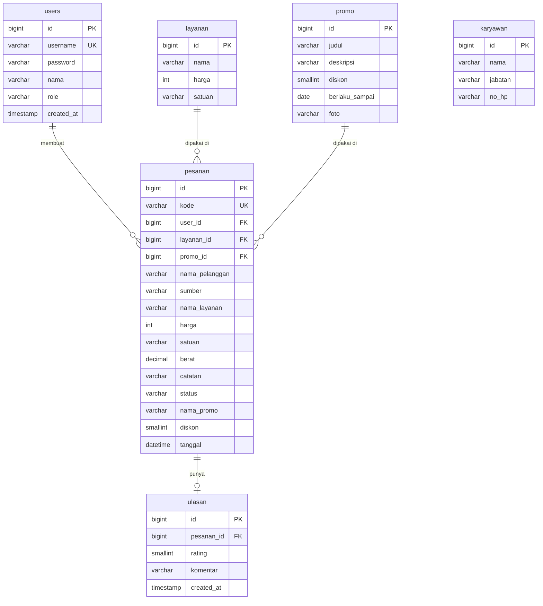

# Panduan GOLaundry

## Kebutuhan

- PHP 8.3 atau lebih baru (Laravel 13 tidak jalan di PHP 8.2)
- Composer
- XAMPP (Apache dan MySQL/MariaDB)
- Ekstensi PHP aktif: `pdo_mysql`, `mbstring`, `openssl`, `fileinfo`, `curl`

Cek versi dan ekstensi lewat CMD:

```
php -v
php -m | findstr /i "pdo_mysql mbstring openssl fileinfo curl"
```

Kelima ekstensi harus muncul. Kalau ada yang tidak muncul, buka `php.ini`, hapus tanda `;` di depan baris `extension=...` yang kurang, lalu buka ulang CMD.

## Instalasi

1. Clone repository atau ekstrak ZIP ke `C:\xampp\htdocs\golaundry-laravel`.

   ```
   git clone https://github.com/aqillanauval/Golaundry-FIXX.git golaundry-laravel
   cd golaundry-laravel
   ```

2. Pasang library Laravel (butuh internet).

   ```
   composer install
   ```

3. Buat file `.env` dan app key.

   ```
   copy .env.example .env
   php artisan key:generate
   ```

   Bagian database di `.env` sudah memakai setelan bawaan XAMPP (`DB_USERNAME=root`, password kosong). Ubah kalau MariaDB kamu memakai password.

4. Buat database. Jalankan Apache dan MySQL di XAMPP Control Panel, buka `http://localhost/phpmyadmin`, klik New, isi nama `golaundry_laravel` dengan collation `utf8mb4_unicode_ci`, lalu Create.

5. Buat tabel dan isi data awal.

   ```
   php artisan migrate --seed
   ```

   Kalau perintah ini gagal, impor file `database/sql/golaundry_laravel.sql` lewat menu Import di phpMyAdmin.

6. Jalankan aplikasi.

   ```
   php artisan serve
   ```

   Buka `http://localhost:8000`. Jendela CMD harus tetap terbuka selama aplikasi dipakai.

### Menjalankan lewat golaundry.test (opsional)

Cara ini memakai Apache XAMPP, jadi tidak perlu `php artisan serve`. Syaratnya PHP bawaan XAMPP juga sudah versi 8.3 (cek dengan `C:\xampp\php\php.exe -v`).

Tambahkan di akhir file `C:\xampp\apache\conf\extra\httpd-vhosts.conf`:

```
<VirtualHost *:80>
    ServerName golaundry.test
    DocumentRoot "C:/xampp/htdocs/golaundry-laravel/public"
    <Directory "C:/xampp/htdocs/golaundry-laravel/public">
        AllowOverride All
        Require all granted
    </Directory>
</VirtualHost>
```

Buka Notepad sebagai Administrator, lalu tambahkan baris ini di `C:\Windows\System32\drivers\etc\hosts`:

```
127.0.0.1   golaundry.test
```

Restart Apache, ubah `APP_URL=http://golaundry.test` di `.env`, lalu jalankan `php artisan config:clear`.

## Akun Awal

Dibuat otomatis oleh seeder.

| Role | Email | Password |
| --- | --- | --- |
| Staff | `admin@golaundry.com` | `admin123` |
| Pelanggan | `pelanggan@golaundry.com` | `pelanggan123` |

Seeder juga mengisi 4 layanan (Cuci Kering, Cuci Setrika, Dry Clean, Cuci Express) dan 2 promo contoh.

## Error yang Sering Muncul

| Error | Penyebab | Solusi |
| --- | --- | --- |
| `could not find driver` | Ekstensi `pdo_mysql` belum aktif | Aktifkan `extension=pdo_mysql` di `php.ini` |
| `SQLSTATE[HY000] [2002]` atau connection refused | MySQL di XAMPP belum dijalankan | Start MySQL di XAMPP Control Panel |
| `SQLSTATE[HY000] [1045] Access denied` | Username atau password database salah | Perbaiki `DB_USERNAME` dan `DB_PASSWORD` di `.env` |
| `Unknown database 'golaundry_laravel'` | Database belum dibuat | Ulangi langkah 4 |
| `No application encryption key has been specified` | App key belum dibuat | `php artisan key:generate` |
| `Your requirements could not be resolved` saat `composer install` | Versi PHP di bawah 8.3 | Pasang PHP 8.3 lalu ulangi |
| `Base table or view already exists` saat migrate | Tabel sudah ada dari percobaan sebelumnya | `php artisan migrate:fresh --seed` (semua data akan terhapus) |
| Halaman 419 Page Expired | Form dibiarkan terlalu lama sehingga token CSRF kedaluwarsa | Refresh halaman lalu kirim ulang |
| Halaman 404 atau muncul daftar file saat membuka golaundry.test | DocumentRoot tidak mengarah ke folder `public` | Periksa `httpd-vhosts.conf`, lalu restart Apache |
| Perubahan `.env` tidak terbaca | Konfigurasi masih tersimpan di cache | `php artisan config:clear` |
| Foto promo gagal diunggah | File lebih dari 2 MB atau bukan JPG/PNG | Pakai file JPG/PNG di bawah 2 MB |

## Struktur Project

```
golaundry-laravel/
├── app/
│   ├── Http/
│   │   ├── Controllers/
│   │   │   ├── AuthController.php        login, registrasi, logout
│   │   │   ├── DashboardController.php   dashboard staff dan pelanggan
│   │   │   ├── ProfileController.php     lihat, ubah, hapus akun
│   │   │   ├── LayananController.php     CRUD layanan
│   │   │   ├── PromoController.php       CRUD promo dan upload foto
│   │   │   ├── KaryawanController.php    CRUD karyawan
│   │   │   ├── PelangganController.php   CRUD akun pelanggan oleh staff
│   │   │   ├── PesananController.php     pelanggan membuat, mengubah, membatalkan pesanan
│   │   │   ├── TransaksiController.php   transaksi kios, isi berat, ubah status
│   │   │   ├── RiwayatController.php     riwayat dan ulasan pelanggan
│   │   │   ├── UlasanController.php      staff melihat dan menghapus ulasan
│   │   │   └── NotaController.php        tampilan dan cetak nota
│   │   └── Middleware/
│   │       ├── CekRole.php               membatasi halaman staff dan pelanggan
│   │       └── TanpaCache.php            halaman tidak bisa dibuka lewat tombol Back setelah logout
│   ├── Models/                           User, Layanan, Promo, Karyawan, Pesanan, Ulasan
│   └── helpers.php                       rupiah(), formatBerat(), tglPendek(), usernameValid(), dll.
├── bootstrap/app.php                     pendaftaran middleware role dan tanpa.cache
├── database/
│   ├── migrations/                       struktur 6 tabel
│   ├── seeders/DatabaseSeeder.php        akun awal, layanan, promo contoh
│   └── sql/golaundry_laravel.sql         cadangan kalau migrate gagal
├── lang/id/validation.php                pesan validasi bahasa Indonesia
├── public/
│   ├── css/style.css                     seluruh tampilan
│   ├── js/                               app.js, dashboard-staff.js, pesanan.js
│   ├── uploads/promo/                    foto promo hasil upload
│   └── vendor/                           Font Awesome dan font Plus Jakarta Sans (lokal)
├── resources/views/
│   ├── layouts/                          app.blade.php (sidebar, topbar), auth.blade.php
│   ├── partials/                         flash, tombol hapus, status, pagination
│   └── auth, dashboard, layanan, promo, karyawan, pelanggan,
│       pesanan, transaksi, riwayat, ulasan, nota, profil, errors
└── routes/web.php                        semua route, dikelompokkan per hak akses
```

Alur satu request, contohnya saat staff membuka halaman Layanan:

```
Browser (/layanan)
  -> routes/web.php
  -> middleware auth, role:admin, tanpa.cache
  -> LayananController@index
  -> Model Layanan (query ke MariaDB)
  -> resources/views/layanan/index.blade.php
  -> HTML dikirim ke browser
```

## Database

Nama database `golaundry_laravel` (MariaDB). Ada 6 tabel aplikasi ditambah tabel `migrations` milik Laravel. Session dan cache disimpan di file, bukan di database.

### Relasi Antar Tabel



Diagram di atas tampil sebagai gambar di GitHub. Di VS Code perlu ekstensi Markdown Preview Mermaid Support.

| Relasi | Jenis | Foreign key | Kalau data induk dihapus |
| --- | --- | --- | --- |
| users ke pesanan | Satu ke banyak | `pesanan.user_id` | `SET NULL`, riwayat pesanan tetap ada |
| layanan ke pesanan | Satu ke banyak | `pesanan.layanan_id` | `SET NULL`, nama dan harga tetap tersimpan di pesanan |
| promo ke pesanan | Satu ke banyak | `pesanan.promo_id` | `SET NULL`, nama promo dan diskon tetap tersimpan di pesanan |
| pesanan ke ulasan | Satu ke nol atau satu | `ulasan.pesanan_id` (unique) | `CASCADE`, ulasan ikut terhapus |
| karyawan | Tidak berelasi | - | - |

### Mapping Tabel, Model, dan Controller

| Tabel | Model | Relasi di model | Controller |
| --- | --- | --- | --- |
| `users` | `User` | `hasMany(Pesanan)` | AuthController, ProfileController, PelangganController |
| `layanan` | `Layanan` | `hasMany(Pesanan)` | LayananController |
| `promo` | `Promo` | `hasMany(Pesanan)` | PromoController |
| `pesanan` | `Pesanan` | `belongsTo(User, Layanan, Promo)`, `hasOne(Ulasan)` | PesananController, TransaksiController, NotaController, DashboardController |
| `ulasan` | `Ulasan` | `belongsTo(Pesanan)` | RiwayatController, UlasanController |
| `karyawan` | `Karyawan` | - | KaryawanController |

### Detail Kolom

**users**: akun staff dan pelanggan.

| Kolom | Tipe | Keterangan |
| --- | --- | --- |
| id | BIGINT, PK | |
| username | VARCHAR(100), unique | Email atau nomor HP untuk login |
| password | VARCHAR(255) | Hash bcrypt |
| nama | VARCHAR(100) | |
| role | VARCHAR(10) | `admin` (staff) atau `customer` (pelanggan), default `customer` |
| created_at | TIMESTAMP | Tanggal daftar |

**layanan**: jenis layanan dan tarif.

| Kolom | Tipe | Keterangan |
| --- | --- | --- |
| id | BIGINT, PK | |
| nama | VARCHAR(100) | Contoh: Cuci Setrika |
| harga | INT | Harga per satuan, harus lebih dari 0 |
| satuan | VARCHAR(20) | `kg`, `item`, atau `pasang` |

**promo**: potongan harga.

| Kolom | Tipe | Keterangan |
| --- | --- | --- |
| id | BIGINT, PK | |
| judul | VARCHAR(100) | |
| deskripsi | VARCHAR(500) | |
| diskon | SMALLINT | Persen, 1 sampai 100 |
| berlaku_sampai | DATE | Promo tidak bisa dipakai setelah tanggal ini |
| foto | VARCHAR(255) | Nama file di `public/uploads/promo`, kosong kalau tanpa foto |

**pesanan**: semua transaksi, baik dari aplikasi maupun kios.

| Kolom | Tipe | Keterangan |
| --- | --- | --- |
| id | BIGINT, PK | |
| kode | VARCHAR(20), unique | Nomor nota, contoh `ORD6ab7da28cce8f`. Dipakai di URL |
| user_id | BIGINT, FK, nullable | Kosong untuk pelanggan kios tanpa akun |
| nama_pelanggan | VARCHAR(100) | |
| sumber | VARCHAR(10) | `aplikasi` atau `kios` |
| layanan_id | BIGINT, FK, nullable | |
| nama_layanan, harga, satuan | VARCHAR, INT, VARCHAR | Salinan data layanan saat pesanan dibuat |
| berat | DECIMAL(6,1) | 0 sampai staff menimbang cucian |
| catatan | VARCHAR(500) | Alamat jemput atau catatan |
| status | VARCHAR(20) | Menunggu Jemput, Diterima, Dicuci, Selesai, Diambil |
| promo_id | BIGINT, FK, nullable | |
| nama_promo, diskon | VARCHAR, SMALLINT | Salinan data promo saat pesanan dibuat |
| tanggal | DATETIME | Waktu pesanan dibuat (WIB) |

Kolom `status` dan `tanggal` diberi index karena sering dipakai untuk filter dan urutan.

**ulasan**: rating dari pelanggan.

| Kolom | Tipe | Keterangan |
| --- | --- | --- |
| id | BIGINT, PK | |
| pesanan_id | BIGINT, FK, unique | Satu pesanan maksimal satu ulasan |
| rating | SMALLINT | 1 sampai 5 |
| komentar | VARCHAR(500) | |
| created_at | TIMESTAMP | |

**karyawan**: data karyawan, tidak terhubung ke tabel lain.

| Kolom | Tipe | Keterangan |
| --- | --- | --- |
| id | BIGINT, PK | |
| nama | VARCHAR(100) | |
| jabatan | VARCHAR(50) | Contoh: Kurir, Kasir, Operator Cuci |
| no_hp | VARCHAR(20) | Angka 9 sampai 15 digit |

### Aturan di Database

Selain validasi di controller, beberapa aturan juga dipasang langsung di database dengan CHECK constraint:

- `users.role` hanya `admin` atau `customer`
- `layanan.harga` lebih dari 0
- `promo.diskon` antara 1 dan 100
- `pesanan.sumber` hanya `aplikasi` atau `kios`
- `pesanan.harga` dan `pesanan.berat` tidak boleh negatif
- `pesanan.diskon` antara 0 dan 100
- `pesanan.status` hanya salah satu dari 5 status
- `ulasan.rating` antara 1 dan 5

Kenapa nama layanan, harga, dan diskon disalin ke tabel `pesanan`? Supaya nota lama tidak ikut berubah kalau harga layanan dinaikkan atau promo dihapus. Total harga dihitung dari kolom salinan tersebut:

```
subtotal = harga x berat
potongan = subtotal x diskon / 100
total    = subtotal - potongan
```

Urutan status pesanan:

```
Menunggu Jemput -> Diterima -> Dicuci -> Selesai -> Diambil
```

Menunggu Jemput hanya dipakai untuk pesanan dari aplikasi yang belum ditimbang. Transaksi kios langsung mulai dari Diterima karena beratnya sudah diketahui. Status hanya bisa diubah oleh staff.